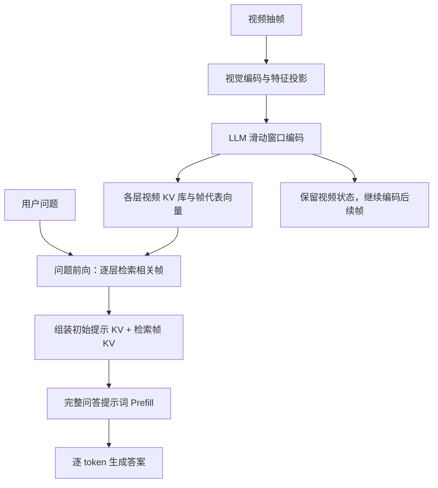

# ReKV 算法执行流程分析

ReKV 的核心是：**视频到来时持续计算并保存各层 KV；问题到来时，从历史 KV 中检索相关帧，直接用这些 KV 生成答案。** 因此，同一段视频可以供多个问题复用。

以下基于当前仓库代码的静态分析，以 `run.sh` 配置的 **LLaVA-OneVision-7B + RVS-Ego 流式问答**为主线。



1. **初始化：给语言模型替换注意力与缓存机制**

   执行入口为：

   ```text
   run.sh
     → video_qa.run_eval.eval_rvs_ego()
     → rekv_stream_vqa.py
     → BaseVQA 所在模块的 work()
     → load_model()
     → patch_hf()
   ```

   `patch_hf()` 替换每层 Self-Attention 的前向实现，使其进入 `rekv_attention_forward()`。每层拥有一个独立的 `ContextManager`，负责视频 KV 保存和检索。

   每个视频开始时，先清空上一个视频的缓存，再执行 `encode_init_prompt()`，生成系统提示词和对话前缀的 KV。这些初始 token 会长期保留。

   对应：[模型加载](model/rekv/llava_onevision_rekv.py#L105)、[注意力替换](model/rekv/patch.py#L35)。

2. **视频编码：分批输入，使用局部因果注意力**

   当前采样率为 `0.5 FPS`，约每两秒采一帧。流式问答程序根据每个问题的 `end_time`，只编码上次位置到当前提问时刻之间的新增帧。

   LLaVA-OneVision 默认每批编码 **64 帧**，每帧对应 **196 个视觉 token**：

   ```text
   视频帧
     → 视频预处理
     → 视觉编码器、投影及池化
     → [1, 帧数 × 196, hidden_dim]
     → language_model(inputs_embeds=video_features)
   ```

   在每层注意力中，先计算当前输入的 Q、K、V，再由 `ContextManager.append()` 完成注意力计算和缓存更新。每个 token 的可见范围主要是最近 `n_local` 个 token 内的因果上下文，以及被单独保留的初始提示词 token。

   当前 `n_local=15000`，约对应 76 帧视觉 token。视频持续增长时，每个 token 的直接注意力范围仍受这个窗口限制。

   对应：[流式编码调度](video_qa/rekv_stream_vqa.py#L35)、[分批编码](model/rekv/abstract_rekv.py#L32)、[窗口注意力](model/rekv/attention/kv_cache_manager.py#L518)。

3. **缓存管理：保留完整 KV，另建轻量检索索引**

   每层缓存包含以下几部分：

   | 数据 | 存放位置 | 用途 |
   |---|---|---|
   | `local_k/local_v` | GPU | 后续视频编码使用的最近窗口 |
   | `init_k/init_v` | GPU | 长期保留的初始提示词 |
   | `global_blocks` | CPU，部分块有 GPU 副本 | 保存完整视频帧 KV |
   | `block_k` | GPU | 每帧一个代表向量，用于检索 |
   | `global_buffer` | GPU | 拼接当前问题所需的 KV |

   视频较短、尚未启动归档时，KV 保存在 GPU 的 `global_remainder` 中。启动归档后，代码按帧建立 `MemoryUnit`，将完整 K、V 保存到 CPU；最近帧还会在局部窗口中保留副本。

   同时，对每帧的 K 在视觉 token 维度取平均，再拼接各注意力头，形成帧代表向量：

   $$
   \bar{k}^{(\ell)}_f
   =
   \operatorname{concat}_{h}
   \left(
   \frac{1}{P}\sum_{p=1}^{P} K^{(\ell)}_{f,h,p}
   \right)
   $$

   其中 $P=196$。对于 GQA，代码会先将 KV heads 扩展到 query heads 数量。

   **均值向量只负责选择帧；真正用于回答的仍是该帧完整的 K、V。**

   对应：[帧归档和代表向量生成](model/rekv/attention/kv_cache_manager.py#L569)。

4. **问题到来：先进行一次专门的检索前向**

   `question_answering()` 首先将各层切换到检索模式，仅输入原始问题文本。选择题的选项和回答格式要求在后续回答阶段才加入。

   每一层分别计算问题 token 的 Q，并在问题长度维度上取平均：

   $$
   \bar{q}^{(\ell)}
   =
   \operatorname{concat}_{h}
   \left(
   \frac{1}{M}\sum_{t=1}^{M}Q^{(\ell)}_{h,t}
   \right)
   $$

   然后对各视频帧打分：

   $$
   s_f^{(\ell)}
   =
   \bar{q}^{(\ell)\top}\bar{k}^{(\ell)}_f
   $$

   评分使用尚未施加 RoPE 的 Q、K。`get_cosine_similarity()` 实际计算的是点积，没有做余弦归一化。

   每层独立选取相关帧，因此不同层可以检索到不同帧。同一层将各头的信息汇总后选帧，各头共享所选帧集合。深层问题表示已经经过前面层的检索注意力，因此检索是随着问题前向逐层发生的。

   默认 `chunk_size=1`，直接选最高分的 `topk` 帧；若设为更大值，则先将相邻帧组成片段，对片段分数取平均后选择。选中结果最终按帧索引排序，保留时间先后关系。视频帧数不足预算时，保留全部帧。

   对应：[问题检索入口](model/rekv/llava_onevision_rekv.py#L33)、[检索评分与选择](model/rekv/attention/kv_cache_manager.py#L422)。

5. **加载检索结果：构造当前问题的上下文**

   每层根据自己的检索结果，构造：

   ```text
   当前问题使用的 KV = [初始提示词 KV, 按时间排序的相关帧 KV]
   ```

   CPU 中被选中的 KV 被加载到 GPU；已有 GPU 副本的块直接复用。GPU 块缓存采用 LRU 淘汰策略，默认最多保留 `128` 个块。

   默认检索 `64` 帧，对应最多：

   $$
   64\times196=12544
   $$

   个视频 token 的 KV，再加初始提示词 KV。

   检索阶段虽然会计算问题自身的注意力，但返回的缓存**不包含这次检索输入的问题 KV**。它输出的是后续回答需要使用的视频上下文。

   此外，缓存保存的是未施加 RoPE 的 K；使用时根据当前拼接序列重新施加位置编码。因此，检索结果保留帧的先后顺序，但不会保留原始帧间的完整时间间隔。

   对应：[检索 KV 加载](model/rekv/attention/kv_cache_manager.py#L343)、[检索与普通解码分支](model/rekv/attention/rekv_attention.py#L65)。

6. **回答生成：完整提示词 Prefill，再逐 token 解码**

   检索完成后，原始视频缓存恢复为编码模式。回答过程使用独立的 `past_key_values`：

   ```text
   检索得到的视频 KV
     → 输入完整问答 prompt
     → 得到首个输出 token
     → 每次输入上一个生成 token
     → 遇到 EOS 或达到长度限制后结束
   ```

   代码虽然调用 `topk(logits, 2)`，实际始终选排名第一的 token，因此属于**贪心解码**。

   问题和答案的 KV 只更新本次回答缓存，不写回长期视频缓存。下一个问题会重新检索；后续视频帧则继续接到原始视频状态上。这也是视频编码能够被多个问题复用的原因。

   对应：[Prefill 与解码循环](model/rekv/llava_onevision_rekv.py#L56)。

当前配置中，几个容易混淆的参数含义如下：

| 参数 | 当前值 | 含义 |
|---|---:|---|
| `num_chunks` | 1 | 评测数据的进程分片数 |
| `encode_chunk_size` | 64 | 每批输入视觉编码器和 LLM 的帧数 |
| `n_local` | 15000 | 局部窗口的 token 数 |
| `retrieve_size / topk` | 64 | 每层检索的帧块预算 |
| `retrieve_chunk_size` | 1 | 检索时连续帧分组的大小 |
| `block_size / exc_block_size` | 196 | 一帧 KV 块大小／注意力内部分块大小 |

从计算开销看，固定窗口下，视频注意力计算随视频长度近似线性增长；每次问题仍需扫描各层的帧代表向量，但完整 KV 的加载和回答上下文受检索预算控制。**CPU 中的完整 KV，以及 GPU 中的代表向量索引，仍会随视频长度增长**，所以不能将其理解为总内存恒定。

当前实现有两点边界：流式评测脚本先读取整段采样视频，再按问题时间模拟增量编码；所分析的缓存路径实现了 CPU/GPU 调度，未见 README 所提磁盘卸载的实现。离线问答则先编码完整视频，再依次回答问题，其检索和生成流程相同。
