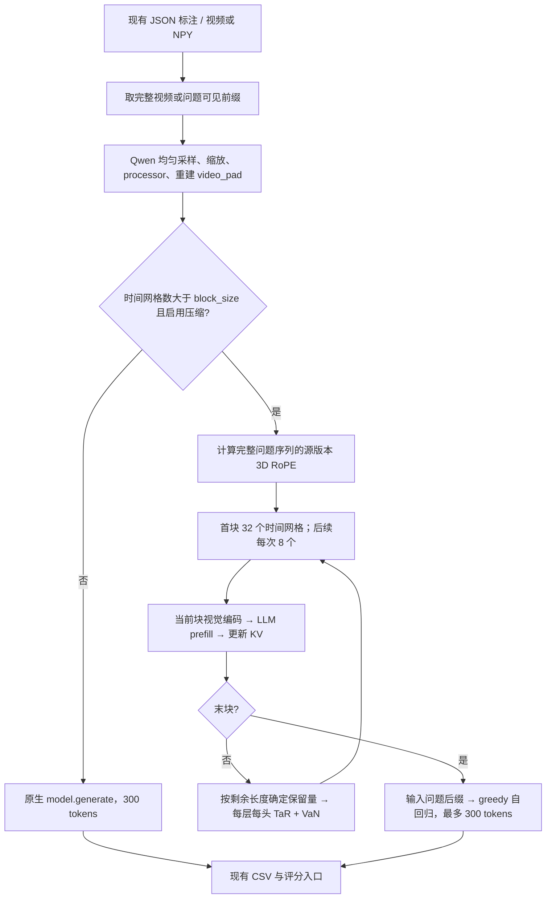

# InfiniPot-V → `infinipot`

本适配以仓库内 `InfiniPot-V/qwen_inference_ovu.py` 和
`InfiniPot-V/kvcache_utils.py` 为执行规范。源 README 说明该发布代码是研究复现，
未包含论文的全部组件；Qwen 路径复现发布代码的行为。
`onevision.py` 另为 LLaVA-OneVision 提供模型适配，复用相同的 TaR/VaN 选择函数。

## Qwen 执行流程

下面描述缓存未命中时的计算；同一视频前缀的后续问题会复用视频 prefill。



1. **输入与单位。** 视频使用 Qwen 的均匀帧采样，默认 2 FPS，最多 768 张原始帧。
   空间缩放设 `max_pixels=128*28*28=100352`。Qwen 的时间 patch 合并相邻两帧；
   源程序的 `frame_number`、`block_size`、`compress_frame_num` 实际均以
   `video_grid_thw[0,0]` 的时间网格为单位。因此 32 个网格通常对应 64 张原始帧。
   token/网格由真实 grid 决定，不能假设固定 128 或 196。
2. **分块。** 首块包含系统前缀（含 vision_start）与 32 个网格；后续仅输入
   `32-24=8` 个新网格。每块独立执行视觉塔，再执行语言模型前向。
   问题后缀不参与视觉 prefill，但计算完整序列的位置时包含问题后缀。
3. **动态尾部预算。** 非末块保留量为 `max(24, 32-剩余网格数)`。
   最后不足 8 个网格时，前一块会多保留一些 KV；末块完全不压缩。
   `compress_frame_num` 是**保留量**，不是删除量。
4. **TaR。** 每层每 KV head 独立选择。将缓存中视觉 K 按当前逻辑网格重排，
   最近 `int(current_frame_num*query_ratio)` 个网格充当 query；对归一化 K 的
   同一空间位置计算相似度，沿 query 网格求均值并取负，选取与近期不同的历史 token。
   TaR 的预算为 `keep_tokens-round((1-tar_ratio)*keep_tokens)`，其中先扣除
   必须保留的全部 query tokens，再对历史做 top-k。这里使用的是已施加 RoPE 的缓存 K。
5. **VaN。** 使用 V 的 L2 norm。可选逐层 3D/2D/1D/不池化（核大小 7/5/3/1），
   默认关闭。将 TaR 选中的位置赋值为全局 `max(score)+1`，再做保留预算大小的
   top-k，按原索引排序后同时 gather K/V。系统 token 始终保留。
   压缩后 token 不再构成完整物理帧，但下一轮仍按 `token_per_frame` 分组；这是源实现的行为。
6. **位置与生成。** 每块使用完整序列对应的原始 3D position IDs，压缩后不重新旋转 K。
   问题生成起点保留源代码的 `position_ids_full[0,0,-1]+1`：它位于完整 prompt
   后面，而不是最后一个视觉 token 后面。分块分支 greedy argmax，EOS 停止，最多 300 tokens；
   非分块分支调用原生 `generate`，保留 checkpoint 的生成配置。
7. **问题隔离与复用。** 同一视频前缀保留一份视频 prefill KV 快照，每题深拷贝后独立生成，
   不继承前一问题的后缀或答案 KV。完整位置仍按当前问题重新计算，保留源生成位置对
   当前问题长度的依赖。RVS 切换可见前缀时重新执行上述流程，因为采样和尾块保留量
   依赖该前缀的总长度，不在旧前缀缓存上增量追加。

## Prefill 复用

Qwen 与 OneVision 均默认启用，无需额外参数：

- 分块路径保存最后一个视频块结束时的 KV；同一视频前缀的后续问题跳过视觉塔、
  视频 LLM prefill 和压缩。Qwen 缓存不包含问题后缀，并逐题重新计算完整三维位置。
- 短视频及禁用分块/压缩的视频路径，先用原生模型处理到最后一个视频占位 token，
  然后向原生 `model.generate` 传完整 prompt、位置、attention mask 和 KV 副本。
  原生生成器只处理未缓存后缀，并继续负责采样、beam search、重复惩罚、EOS 和长度限制。
  OneVision 的原生视频占位 span 包含末尾 newline，该 token 也包含在快照中。
- 每题深拷贝 KV 张量及缓存元数据，生成异常不会污染快照。仅保留当前前缀的一份快照，
  原生与分块路径切换会重建；视频前文本、位置或压缩配置不匹配时也会重建。
  `set_video()`（包括再次提交同一张量）、`reset()`、`close()` 均使快照失效。
- 纯文本无视频可复用，继续原生生成。若调用方显式关闭生成 KV、指定其他 cache 实现
  或启用原生 chunked prefill，则保留其原生执行方式，不注入 DynamicCache 快照。
- 当前仍逐题执行 processor 和提示组织；复用省去的是视觉编码及视频 prefill。
  原生完整 prefill 改为前缀/后缀两次前向，可能出现浮点舍入差异，不承诺逐 bit 相等。

复用会额外常驻一份视频 KV，生成时另有工作副本；显存不随问题数量累积。
禁用压缩的视频快照包含完整视频 KV，可能明显增加显存。采样多返回序列或 beam search
还会按原生生成需求扩展工作副本。模型权重、注意力后端或视频张量被原地修改后，
应重新调用 `set_video()`，避免继续使用旧快照。

## 参数来源

Python CLI 默认采用发布的 `scripts/run_sample.sh` 与 README 的 InfiniPot-V 实验配置。
本地 `run_infinipot.sh` 默认运行 OneVision，显式传入 `block_size=41`、`compress_frame_num=31`；
可在命令末尾覆盖这两个参数。
源 Python parser 本身默认关闭分块，是不同的 baseline 配置；两者在此明确区分。

| 参数 | Python CLI / 发布实验脚本 | 源 Python parser |
|---|---:|---:|
| `block_size` | 32 | -1 |
| `compress_frame_num` | 24 | 0 |
| `compression_method` | infinipot-v | uniform |
| `max_frames_num` | 768 | 32 |
| `tar_ratio` | 0.5 | 0.5 |
| `query_ratio` | 0.25 | 0.25 |
| `adaptive_pooling` | false | false |
| `per_frame` | false | false |
| 生成上限 | 300 | 类常量 300 |
| 解码采样 FPS | 2 | qwen-vl-utils 默认 2 |
| 视频 `max_pixels` | 100352 | 类常量 100352 |

`per_frame` 在源压缩函数中没有使用，这里同样不改变 token 选择。
源 `use_block_processing` 仅用于打印，实际分支条件是 `block_size>0`、
`frame_count>block_size`、`compress_frame_num>0`，本适配保留实际条件。
没有沿用源程序硬编码的 MLVU `.pt` dump 路径；直接读取现有视频，避免依赖另一份数据布局。

显式传 `--block_size -1 --compress_frame_num 0 --compression_method uniform --max_frames_num 32`
即可使用源 parser 的 baseline。`--max_new_tokens` 是可选的显式实验覆盖；
默认情况下，BaseVQA 的 16/256/1024-token 限制不会覆盖源算法的 300。
无效块大小、TaR 查询预算会报错，不通过截断 top-k 等方式偷偷修改算法。

## LLaVA-OneVision 支持与预算

支持 `llava_ov_0.5b`、`llava_ov_7b`、`llava_ov_72b`，可用于下列全部七个数据集。
模型适配针对仓库固定的 Transformers 5.5.4 接口：

- 采用 checkpoint 的聊天模板、视频 processor、视觉塔和池化特征。逐块处理视觉输入，
  压缩前不会先建立完整视频的 KV。
- `block_size` 和 `compress_frame_num` 以采样后单帧计数；单帧前缀不复制，
  奇数帧数不向偶数取整。均匀采样和可见前缀截断规则沿用共享加载器，缩放由 OneVision processor 完成。
- 每层每 KV head 使用原有 TaR/VaN（或 uniform、swa）选择；尾块保留量也沿用
  `max(compress_frame_num, block_size - remaining_frames)`，最后一块不压缩。
- 一维 RoPE 使用原始完整序列位置。压缩后位置不按剩余缓存长度重编号。
  OneVision 的 learned video newline 在视频末尾追加一次，随后输入问题并 greedy 生成。
- 分块路径自动复用当前视频前缀的 prefill KV 和原始结束位置。同一前缀的后续问题
  不再执行视觉塔、视频 LLM prefill 或压缩；每题深拷贝 KV 和缓存元数据后独立生成，
  问题后缀、video newline 和答案不会写回可复用快照，生成异常也不会污染它。
  视频前的文本 token 或压缩配置变化时重新计算。`set_video()`、`reset()` 和 `close()`
  都会释放旧快照；仅保留当前前缀，不跨不同可见前缀增量追加。
- 短视频和禁用压缩的视频也复用原生 prefill，再调用原生 `generate`；纯文本直接原生生成。

设实际每帧池化 token 数为 `P`，视觉缓存峰值为 `block_size * P`，
常规压缩后保留量为 `compress_frame_num * P`。常见 OneVision checkpoint 的 `P=196`；
运行时从真实视觉特征推导，不硬编码。系统前缀、一个 video newline、问题和生成 token 额外占用缓存。
上述 token 上限描述单份工作缓存。复用还会在模型设备上常驻一份视频 prefill
快照（系统前缀 + 末块完成后的视觉 KV），每题需要复制一次；生成时同时存在快照和工作缓存。
因此这项优化减少重复计算，但增加了显存占用，不能把单份 token 上限当作总 KV 显存上限。
同一模型实例使用期间，若手动修改权重、注意力后端或原地修改视频张量，应调用 `set_video()`
重新提交视频以使快照失效。

```bash
# 视觉 KV 峰值 8036 <= 8192；常规压缩后保留 6076 tokens。
bash run_infinipot.sh --model llava_ov_7b \
    --block_size 41 --compress_frame_num 31 \
    --tar_ratio 0.5 --query_ratio 0.25

# RVS 可见前缀问答
bash run_infinipot.sh --model llava_ov_7b --dataset rvs_movie \
    --block_size 41 --compress_frame_num 31 --max_samples 1
```

按帧设置的上限无法恰好表示 8192/196；41 帧为 8036 tokens，42 帧为 8232 tokens。
Qwen 的 `64/48` 配置在 `P=128` 时对应 8192/6144，在 OneVision 的 `P=196` 时
则对应 12544/9408，跨模型比较时需要换算。

## 数据集与模型

| 路由 | 现有数据集 | 输入 |
|---|---|---|
| offline | mlvu、qaego4d、egoschema、activitynet_qa、cgbench | 完整视频，依次回答 conversations |
| stream | rvs_ego、rvs_movie | 每个问题 `end_time` 前的视频前缀 |

沿用 `run_eval.DATASETS` 的标注路径、样本限制、分块调度、CSV 字段与评分器。
选择题保留源 MLVU/EgoSchema 提示词，并扩展到 CGBench 的 A–H 选项；开放题直接使用原问题。
EgoSchema 私有答案仍遵循现有仓库的占位约定，最终评测以其 submission 为准。

Qwen 路径的普通视频遵循 qwen-vl-utils 的 `smart_nframes` + rounded linspace，而不是 ReKV 的固定步长。
源依赖未锁定 qwen-vl-utils 版本，本适配固定采用 **0.0.14** 的帧数及 bicubic resize 行为，
不额外安装该包。`--sample_fps` 可覆盖默认 2；其他方法仍默认 1。
NPY 按仓库约定视为 1-FPS RGB 数组，先截取前缀，再按相同规则采样，不人为补足到 2 FPS。
RVS 保留 source timestamp `< end_time` 的帧，不读取未来；`start_time` 不用于裁剪历史，
与仓库的前缀问答任务一致。此边界采用真实时间，不是 ReKV 的采样数组切片。
零帧前缀执行纯文本问答；Qwen 单帧前缀重复该帧构成时间 patch，OneVision 保持单帧。

Qwen 路径支持当前模型表中的 `qwen2_5_vl_3b`、`qwen2_5_vl_7b`、`qwen2_5_vl_72b`，
OneVision 路径支持上述三个 `llava_ov_*` preset。源项目还支持 Qwen2-VL，
当前仓库没有其 preset；Video-LLaVA 尚未接入 InfiniPot。两条加载路径均使用 `dtype='auto'` 和
`attn_implementation='flash_attention_2'`，通过共享加载器固定到进程内 `cuda:0`。
eval 用 `--gpus` 或 `CUDA_VISIBLE_DEVICES` 为每个进程分配一张 GPU，72B 也使用同一规则。

```bash
# 本地运行脚本配置；可覆盖 dataset、模型、样本上限、参数
bash run_infinipot.sh --max_samples 5
bash run_infinipot.sh --dataset rvs_movie --max_samples 1

# 统一调度入口
python -m video_qa.run_eval --method infinipot --model qwen2_5_vl_7b \
    --dataset egoschema --max_samples 5

# 仅预测，不触发开放题评分服务
python -m video_qa.infinipot_stream_vqa --model qwen2_5_vl_7b \
    --anno_path data/rvs/ego/ego4d_oe.json --save_dir results/infinipot_rvs \
    --max_samples 1
```

结果目录记录压缩、帧数、生成参数及 FPS。CSV 附加同样的配置字段。

## 兼容性与验证

源版本要求 Transformers 4.57.3；当前仓库固定 5.5.4。
`cache.py` 原样复制源压缩函数；`core.py` 保留源分块和生成函数，只对视觉特征的
`pooler_output` 封装及 RoPE 调用做兼容处理。
`rope.py` 保留 Transformers 4.57.3 的 `get_rope_index`，避免新版在视频后的文本位置
计算差异。runtime 仅绑定自身模型实例的位置计算函数，关闭时还原；无全局 attention patch。
源非分块分支的未定义全局 `MAX_GEN_TOKENS` 修正为类常量引用，否则短视频会直接报错。

```bash
PYTHONPATH=tests python -m unittest test_infinipot -v
PYTHONPATH=tests python -m unittest test_infinipot_onevision test_infinipot_reuse test_all_model_methods test_eval_devices -v
```

测试覆盖源函数逐层逐头 K/V 差分、三种压缩方式与池化组合、真实随机小 Qwen 的
33/40/41/49 网格块边界和生成位置、短视频原生分支、问题隔离、NPY 前缀、全部 7 个数据集
路由及 CSV 合约。测试使用本地 `InfiniPot-V/` 作为 oracle，源目录缺失时仅跳过差分部分。
另已用源 sample MP4 对比 qwen-vl-utils 0.0.14，16 帧采样及缩放张量逐元素一致。

OneVision 测试使用真实随机小模型和真实 processor，检查未压缩分块路径与原生前向的 logits、
三种压缩方式及池化开关、预算与尾块、K/V 配对、前缀保留、原始位置、video newline、
单帧/奇数帧采样、问题隔离、三种模型 preset 的全部数据集路由。复用测试覆盖三种压缩方式
和池化开关，对比每题重新 prefill 与复用的逐 token logits/答案，检查视觉编码与压缩调用次数、
视频/前置文本/配置变更失效、生成异常隔离，以及 RVS 相同前缀复用与切换后重建。
`test_infinipot_reuse` 额外对比 Qwen 分块路径的问题相关生成位置，以及两种模型原生路径
的 greedy、固定随机种子采样、多返回序列、beam search、重复惩罚和 EOS；检查原生/分块
切换、禁用压缩的视频复用和显式关闭生成 KV 时的原生回退。
这些检查不需要下载权重；预训练 OneVision 的 GPU 推理和数据集准确率尚未测量。

2026-11-05 复查补充了独立的跨版本运行对照：

```bash
# reference-path 指向独立的 Transformers 4.57.3 + 兼容依赖目录，
# 不修改当前环境；本脚本不下载依赖或预训练权重。
python tests/check_infinipot_versions.py --reference-path /path/to/transformers457
```

相同随机小 Qwen 权重，在 4.57.3 中运行源类，在 5.5.4 中运行适配类；
覆盖 2/32/33/41/49 个时间网格。CPU FP32/eager 条件下，processor 的像素与 token 张量、
完整位置、每次 forward 的 K/V 和 logits，以及生成结果全部一致，最大绝对差为 **0**。
该对照直接执行源预处理与生成函数；仅给源非分块分支补上缺失的生成上限全局常量，
并将双方生成长度缩短到 3 tokens。源文件未修改。

2026-11-11 加入 Qwen 和原生生成路径的 prefill 复用后重跑同一跨版本检查：
5 种长度全部通过（`rtol=1e-5, atol=1e-6`），最大绝对差 **8.9407e-08**，生成答案一致。
原生视频 prefill 被拆成前缀和后缀前向，因此当前结果不再是此前的逐 bit 零差异。

复查还修正了两处适配边界：

- 答案提取按真实选项数保持源 A–D/A–E 正则；此前统一 A–H 会把四选题中的
  `Final answer: D` 误取成 F。五选题的空白/括号处理也保留源行为。
- TaR 预检查纳入实际视频长度和动态尾部预算。例如 `block_size=32`、
  `compress_frame_num=1`、33 个网格时，源程序实际保留 31 个网格，不能按保留 1 个误拒绝。
  TaR 关闭时允许源程序未使用的 `query_ratio=0`。

当前执行环境无可用 CUDA，未完成预训练 Qwen GPU 推理或数据集准确率测量；
上述结果验证了代码流程及小模型的跨版本一致性，不等同于预训练模型在 GPU 上的
逐 bit 输出一致或论文指标复现。RVS/NPY、零/单帧前缀及更多选项是数据集适配扩展；
源项目不含这些任务入口。默认参数对应发布实验脚本，而非默认关闭压缩的源 Python parser。
